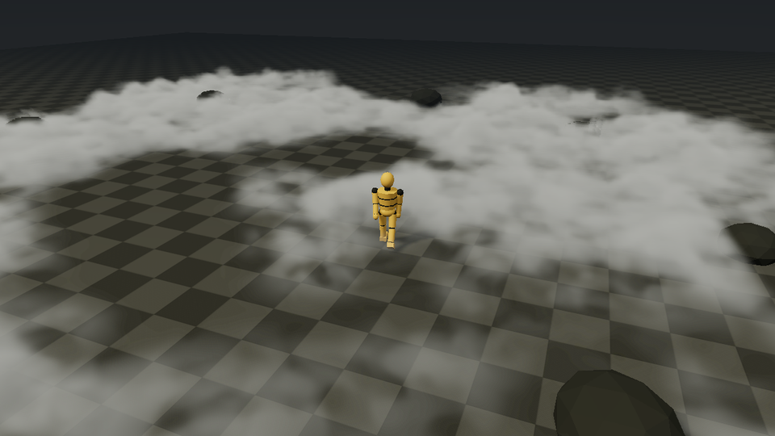

# FogLab

Interactive ground fog you can take apart. Three motion models share a test world and interchangeable mesh and volume renderers.

**Version 0.1.0** · WebGL 2 · Three.js r180 · MIT

[Release destination](https://tront.xyz/fog/) · [Standalone HTML destination](https://tront.xyz/fog/FogLab.html) · [How it works](docs/how-it-works.md)

*Preview captured from the actual Three.js scene and shaders through native software OpenGL.*

## What to try

- **Compare the motion.** Keep the mesh renderer selected and switch between Analytical, Hybrid, and Stable fluids. Use A/B or All three to compare the same walking path and camera.
- **Compare the rendering.** Keep Stable fluids selected and switch between Mesh, Raymarch, and Layered. The simulation is independent of the renderer.
- **Inspect the mechanism.** Pause, single-step, switch to density or velocity, and enable wireframe. Pressure and curl inspection belong to the fluid backend.
- **Share the experiment.** Copy a preset link, or export/import its JSON. A link restores settings and starts from the initial world; it does not save the evolving GPU textures.

The default is **Stable fluids + Raymarch**, a flat reference stage, neutral lighting, and automatic movement. The forest, hills, four fog shells, and extra actors are optional inspection settings. See [the technique guide](docs/how-it-works.md) for what each model actually computes.

## Run it

The downloadable `FogLab.html` contains the engine, application, shaders, and procedural assets. Open it directly in a browser with WebGL 2 enabled. There are no CDN requests, external fonts, accounts, or runtime asset downloads.

To build from source, use **Node.js 22 or newer** with npm:

1. Clone with `git clone https://github.com/TrentSterling/fog.git`.
2. Enter the checkout with `cd fog`.
3. Run `npm run build`.
4. Open `dist/FogLab.html` in your browser.

**No `npm install` is required.** The build uses Node's standard library and the vendored Three.js distribution. It emits `dist/index.html`, `dist/FogLab.html`, and the preview assets.

For an existing checkout on Windows, open PowerShell in the repository, run `git pull --ff-only`, then `npm run build`. Open `dist\FogLab.html` from Explorer. Run `npm test` for the Node tests and `npm run check` after building to check the packaged files. Those checks do not substitute for running the shaders on a browser/GPU.

## Controls

| Action | Control |
| --- | --- |
| Move the mannequin | WASD or arrow keys |
| Sprint | Shift while moving |
| Orbit | Left drag |
| Stir with a brush | Right drag, or Shift + drag |
| Zoom | Scroll wheel |
| Radial interaction pulse | Space or Pulse button |
| Pause/resume | P |
| Advance one simulation tick | Step button while paused |
| Reset the fields and actors | R |
| Toggle automatic movement | T |
| Cycle the camera | C |
| Hide/show the interface | H |

Movement takes over from auto walk. Touch dragging orbits the camera; the Pulse button remains available. Presets, image capture, shader export, and optional GPU diagnostics are available in the interface.

## The three motion models

| Model | Persistent state | Work per simulation update | Useful for |
| --- | --- | --- | --- |
| Analytical | Up to 24 shared trail samples on the CPU | No state-update render passes | Studying geometry and UV deformation without a solver |
| Hybrid | A pair of RGBA16F textures | One fullscreen state pass | Persistent advected wakes without pressure projection |
| Stable fluids | Eight RGBA16F textures | `P + 7` passes with confinement; `P + 6` without | Comparing projected flow against the cheaper approximations |

`P` is the pressure-iteration setting. At the initial 18 iterations with confinement enabled, the fluid backend performs **25 passes per 30 Hz update**. These counts exclude initialization, the opaque scene, fog rendering, and compositing. Analytical rendering still performs shader work; zero simulation passes does not mean zero cost. Implementation: [sim.js](src/sim.js) and [fog.js](src/fog.js).

## What this release does and does not establish

This is an original visual experiment inspired by [the ground-fog reference video](https://www.youtube.com/watch?v=Sm8x4lOGOYE). It is **not a reconstruction of Nintendo's implementation**, and it does not include Nintendo assets or shaders.

The fluid solver is horizontal and two-dimensional. Height and billows are reconstructed during rendering. Hills and rocks affect visibility, but they are not obstacles in the velocity solve. Density is deliberately cleared, replenished, and shaped for the effect, so this is not a mass-conserving physical smoke model. MacCormack advection, a 3D solver, and WebXR are not implemented.

Hybrid and Stable fluids require renderable half-float targets through `EXT_color_buffer_float`. When that capability is absent, the application exposes Analytical mode instead. A working WebGL 2 context is still required.

The performance panel reports the current device and view. GPU timing covers the whole sampled frame when timer queries are available; the fallback is explicitly labeled **CPU submission time**. A/B views add rendering work, and the 30 Hz simulation can step zero or more times per display frame. Use Solo and a fixed preset when investigating cost. This release makes no Quest frame-rate claim.

## Source map

| File | Responsibility |
| --- | --- |
| [src/sim.js](src/sim.js) | GPU motion backends, shared initial fog-bank recipe, diagnostics |
| [src/fog.js](src/fog.js) | Analytical field sampling, mesh/shell/volume rendering, compositing |
| [src/world.js](src/world.js) | Terrain, neutral stage, mannequin, optional forest |
| [src/app.js](src/app.js) | Fixed-step updates, input, cameras, resources, timings |
| [src/presets.js](src/presets.js) | Validated preset serialization and share-link codec |
| [src/learning.js](src/learning.js) | Guided comparisons and explanatory UI |
| [src/lab-tools.js](src/lab-tools.js) | Shader export and opt-in readback diagnostics |
| [src/template.html](src/template.html), [src/style.css](src/style.css) | Interface |
| [scripts/build.mjs](scripts/build.mjs) | Assemble the standalone files |
| [vendor/three.cjs](vendor/three.cjs) | Pinned Three.js r180 distribution |

Shader export produces the original GLSL blocks, not a ready-made Unity package. Engine prefixes, uniforms, texture conventions, and terrain functions must be supplied when porting them.

## Publishing

The public project destination is `https://tront.xyz/fog/`. GitHub Pages should serve the generated `dist` directory for this repository. Asset paths must continue to work beneath `/fog/` and when the standalone file is opened locally.

The workflow tests and builds the release, then checks the repository's Pages configuration. If Pages is disabled or its source is not **GitHub Actions**, the build succeeds, deployment is skipped, and the workflow summary explains the setup step.

For first publication, open the repository's **Settings → Pages**, choose **GitHub Actions** as the source under **Build and deployment**, then manually run **Build and publish FogLab** from the Actions tab. After that setup, pushes to `main` deploy automatically. Check the deploy job's result for publication status.

`tront.xyz` is already configured at the account/root site. **Do not add a project `CNAME` or change the root domain configuration for this release.** No application server is required.

## Credits and license

FogLab code and procedural assets: copyright 2026 Trent Sterling, [MIT](LICENSE). Three.js retains its own MIT notice; see [third-party notices](THIRD_PARTY_NOTICES.md). The [technique guide](docs/how-it-works.md#references) links the original video and the fluid/noise references used for this experiment.
