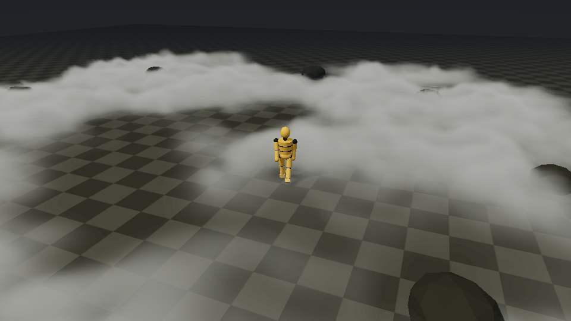

# FogLab 0.3.0 validation

## Automated checks

The release gate is `npm test`, `npm run build`, and `npm run check` using Node 22 or newer. The suite has 49 tests covering the preset codec, fluid math and boundaries, actor interactions, the exact worker protocol, fixed-step scheduling, and complete application coordination.

The nine application integration tests execute the production `app.js` and its normal animation loop in a controlled Node VM. They use real presets, interactions, the clock, and Three.js camera/math classes. Browser/graphics boundaries and worker completion timing are controlled to check pending results, reset, pause, manual steps, camera responsiveness, settings snapshots, bounded slow-worker behavior, and both fallback paths. These tests do not emulate GPU rendering.

The worker tests use real Node worker threads and transferred ArrayBuffers with the exact embedded worker source. They check numerical parity, packet reuse, attached texture storage, stale-generation handling, paused inspection, half-float packing, errors, timeouts, and disposal.

The packaging check parses every source module and embedded executable script, verifies that the embedded worker matches the checked-in sources, compares both offline license notices with their originals, checks unique HTML IDs, and verifies identical hosted/downloadable HTML with no external script or stylesheet dependency.

## Actual browser checks

A Chrome 156 browser ran six checks using actual Blob workers, real transferable buffers, and real Three.js DataTexture objects. All six passed: initialization, six exact-parity simulation ticks, paused pressure/curl inspection, in-flight reset/resize/obstacle changes, half-float packing, and disposal. A context shim selected the texture upload format; this check did not create a WebGL renderer.

The demo's Credits dialog, offline license disclosure, and CPU execution selector were exercised in the browser. Credits were visually checked at desktop width and in a 390 × 844 viewport. The CPU / GPU guided experiment prepared the intended comparison and execution setting.

WebGL 2 was unavailable in this browser. It displayed the explicit saved-render fallback; browser frame rate and live GPU appearance were not measured.

## Native rendering parity

The actual Three.js world and shipping fog shader were rendered through native Mesa GLES. The production worker facade and protocol ran over real Node worker threads, with identical inputs supplied to the main-thread CPU solver.

| Check | Result |
| --- | --- |
| Grid | 64 × 64 |
| Simulation | 180 ticks, 6 simulated seconds |
| Inputs | Shipping seeded noise, identical walking/slash inputs, rock obstacles |
| Rendering | 960 × 540 raymarch, low quality preset, RGBA32F upload |
| Packed field | 0 differences among 16,384 values |
| Obstacle mask | 0 differences among 4,096 values |
| Rendered image | 0 differences among 2,073,600 RGBA channel values |
| Worker packets | 1 allocation and 181 reuses |
| Texture ownership | Upload arrays and shared noise atlas remained attached |

The main-thread and worker PNGs have the same SHA-256: `9e450e00f7146ca9175831a0dcf264095696ae2905d118a7cf3e3985c24e389e`.

The [numeric report](v0.3.0-native-parity.json) records settings, module hashes, image hashes, the renderer, and comparison values. This establishes parity for the tested path and scene. It is not a browser benchmark, a claim that CPU and GPU fluid numerics are identical, or a guarantee of performance on other devices.

## Release and hosting

Source changes are saved to GitHub checkpoints before promotion to `main`. The repository's `AGENTS.md` carries that requirement for subsequent editing sessions.

Publishing is checked separately. GitHub Pages requires its initial repository setting to be enabled; a source push or passing build does not establish that the public project URL serves this version. See [Publishing](../../README.md#publishing).
