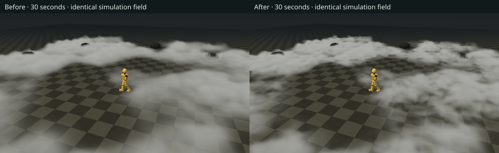

# FogLab 0.4 visual gauntlet

## Decision

Keep the broad banks and deliberate clearings; restore finer, irregular structure through their volume. The selected renderer is **filtered-warped**, anonymous **A** in the final review. Both independent model critics accepted A and C as worthwhile visible improvements. Their ordering of the two was a low-confidence tie. A was selected because its curl-offset height slices avoid globally aligned layer boundaries.

This was an iterative visual comparison, not a human preference study. The critics received anonymized rendered pictures and a visual brief. They did not see source, candidate settings, the mapping key, or one another's reviews. Their unedited written assessments and the mapping keys are retained here. Their approval describes an incremental improvement; it does not establish an exact recreation of the reference video.

## Fourteen configurations, three rounds

| Round | Candidates | Result |
| --- | --- | --- |
| 1 | Original, parameter-only adjustment, finer 2D band, edge erosion, aggressive erosion | No complete pass. Parameter adjustment stayed clean but soft. Shader alternatives produced sheared curtains and sampling artifacts. |
| 2 | Parameter control plus volume, stronger lighting, softer volume, medium-only erosion, physical-height detail, airier physical-height detail | Physical-height versions passed one critic; the other wanted stronger visible folds. Unfiltered detail became grainy at grazing angles. |
| 3 | Original, physical-height version, filtered, filtered-soft, filtered-warped | Both critics accepted filtered and filtered-warped. Selected filtered-warped. |

The original and repeated controls count once: fourteen distinct shader/settings configurations were rendered. The parameter-only adjustment used density 1.05, billow detail 1.35, and vertical shear 1.2. The winning default retains density 1.25, billow detail 1, and shear 1.

- [Round 1 critique](round1-critic.md), [mapping](round1-key.json)
- [Round 2 critique A](round2-critic-a.md), [critique B](round2-critic-b.md), [mapping](round2-key.json)
- [Round 3 critique A](round3-critic-a.md), [critique B](round3-critic-b.md), [mapping](round3-key.json)
- [Historical source audit](../wisp-source-audit.md)

## Controls and provenance

Every candidate in a view uses the same seeded atlas, actor path, completed simulation tick, camera, terrain, lighting, field resolution, ray count, and fog render scale. Except for the explicitly identified parameter candidates, settings are identical. Baseline source is pinned to `9702cfed3e3d0e9dd66f723c183ffad8be97844c`.

Rounds 1 and 2 use 960×540 output; the final round uses 1280×720. All default comparisons use 128² fields, 32 ray samples, and 80% fog render scale. The candidate images are actual production Three.js scenes and GLSL rendered through native Mesa GLES/llvmpipe. They are not image generation, browser screenshots, or hardware GPU benchmarks.

The harness preserves source, atlas, completed raw field, and image hashes. The native baseline reproduces byte-for-byte. The final default reproduces the selected candidate's two final-round PNGs byte-for-byte; Wisp detail zero reproduces the two original PNGs byte-for-byte at the same tick and cameras. These checks establish those captured views, not every possible device or scene.

See [harness validity](harness-validity.md) for differences from a live browser, including a deliberately locked camera and synchronous CPU adapter. Chromium could not initialize its process socket in this environment; shader rendering therefore used the native path.

## Reproduce the candidates

From a full checkout with the baseline commit available:

```sh
python scripts/visual/make-variants.py --out /tmp/foglab-review
python scripts/visual/refine-variants.py --out /tmp/foglab-review
python scripts/visual/refine-physical.py --out /tmp/foglab-review
python scripts/visual/refine-filtered.py --out /tmp/foglab-review
node scripts/visual/capture.cjs --source /tmp/foglab-review/candidates/filtered-warped --variants /tmp/foglab-review/filtered-warped.json --out /tmp/foglab-review/final
```

The optional renderer requires the native dependencies described in [scripts/visual/README.md](../../../scripts/visual/README.md). The application build itself still needs only Node and the vendored engine.

## Final rendering validation

The selected source passes all 50 application tests, the self-contained build, packaging checks, and independent code review. The expanded native rendering run passed **99 captures**: 95 at 960×540 and four at 1280×720. All captured shaders compiled, frames were nonblank, GL checks were clean, and simulated fields were finite.

Across the 32 original baseline scenarios, all 31 non-null raw fields and all 32 camera configurations match exactly. The 61-frame slash sequence and 16-frame steady-camera phase-boundary sequence each use consecutive ticks at 30 frames per second. The measured phase-wrap change is comparable to ordinary adjacent frames, with no large reset spike in that sample.

Low 20-step quality and the column profile retain horizontal ray strata at shallow angles. Matched old-source renders show this limitation already existed. The high 48-step preset is cleaner. This release improves the visual structure; it does not eliminate every sampling artifact or establish a mobile/VR frame-rate target.

[Full validation and limits](final-validation.md) · [Summary](final-summary.json) · [Field comparisons](field-comparison.json) · [Exact hero matches](hero-equivalence.json) · [Losslessly packaged rendering evidence](media/)



[All fourteen candidates](media/candidate-overview.webp) · [Original and selected hero](media/comparison.webp) · [Slash sequence at 30 FPS](media/slash-30fps.mp4)

Publication is a separate gate. The branch workflow checks the configured source, confirms the exact Pages commit, then requires the publicly served manifest and both HTML files to match the verified local build hash. Its GitHub Actions summary records the observed publication result.
